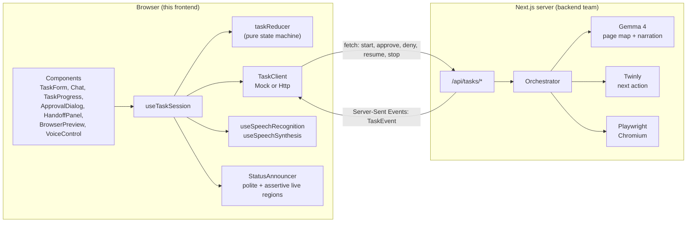

# AccessPilot

> Hackathon project (Gator Hack V, UF AI Days 2026). Open source, MIT licensed.

AccessPilot is a voice-first assistant that completes confusing website tasks for people who use
screen readers, while keeping them informed and in control.

## Why

Many websites are built for sighted mouse users. Unlabeled buttons, date pickers made of `div`s,
and errors shown only in red leave a screen reader announcing "button, button, image," and the
user gets stuck. AI agents can click through websites, but they don't keep a blind user informed,
in control, and asked before anything consequential happens. AccessPilot does.

## Features

- **Page map:** "This page has a login link, a 6-field form, and a Submit button."
- **Step-by-step narration** while a separate browser window does the work.
- **Approval before anything consequential:** it reads back every detail and asks "Should I
  submit?" Nothing happens without an explicit yes. Escape and unclear answers never approve.
- **Hand-offs:** for passwords, card numbers, and CAPTCHAs it hands control back and waits.
- **Stop from anywhere:** one keypress (Alt+Shift+S) or the word "stop".
- **Voice or keyboard:** push-to-talk in Chrome, and full keyboard operation in any modern
  browser.

## Getting started

Requires Node.js 20.9 or newer.

```bash
git clone https://github.com/varshith-k/AccessPilot.git
cd AccessPilot
npm install
npm run dev
```

Open <http://localhost:3000>. With the default settings, the full scholarship demo runs on
scripted mock data, so no backend or API keys are needed.

---

## Frontend

The Next.js UI handles voice, narration, approvals, stop, progress, and the browser preview. It
talks to the backend only through the contract in [`lib/contracts/`](lib/contracts/), documented
in [docs/CONTRACT.md](docs/CONTRACT.md).

### Scripts

| Command                        | What it does                                                |
| ------------------------------ | ----------------------------------------------------------- |
| `npm run dev`                  | Start the app at http://localhost:3000                      |
| `npm run build` / `npm start`  | Production build and server                                 |
| `npm run lint`                 | ESLint (Next.js core web vitals + strict jsx-a11y)          |
| `npm run typecheck`            | TypeScript in strict mode                                   |
| `npm test`                     | Unit and integration tests (Vitest) with coverage           |
| `npm run test:e2e`             | Playwright end-to-end tests against `next dev` in mock mode |
| `npm run format`               | Prettier                                                    |
| `npm run generate:screenshots` | Regenerate the mock screenshot images                       |

To run the E2E tests with an installed Google Chrome instead of Playwright's bundled Chromium,
set `PLAYWRIGHT_CHANNEL=chrome`. CI (`.github/workflows/frontend.yml`) runs lint, typecheck,
tests, and E2E on every push and pull request.

### Environment variables

| Variable                  | Values                     | Effect                                                                      |
| ------------------------- | -------------------------- | --------------------------------------------------------------------------- |
| `NEXT_PUBLIC_TASK_CLIENT` | `mock` (default) or `http` | `http` uses the real backend at `/api/tasks/*`. No code changes are needed. |

The browser never calls Twinly or Gemini, and no API keys belong in frontend code or in
`NEXT_PUBLIC_*` variables. Backend secrets go in `.env.local`, which git ignores.

### Mock scenarios

In development, add `?mock=<scenario>` to the URL to choose a scenario, even when
`NEXT_PUBLIC_TASK_CLIENT=http`. Add `&mockSpeed=0.1` to play it ten times faster. Both are
ignored in production builds.

| Scenario            | What happens                                                                                                     |
| ------------------- | ---------------------------------------------------------------------------------------------------------------- |
| `scholarship-happy` | Page map, 5 steps filling a scholarship form, approval before submit, then "Confirmation number 4821". (default) |
| `scholarship-deny`  | Same form, but it picks the wrong program so you have a reason to answer "Don't submit".                         |
| `password-handoff`  | Reaches a password field and hands control to you until you press Continue.                                      |
| `failure`           | Fails at the program dropdown with a recoverable error and a Try again option.                                   |
| `slow-network`      | Long gaps between updates, to show the "Still working" messages.                                                 |

### Keyboard shortcuts

Press `?` in the app to see this list. The shortcuts use Alt+Shift so they don't collide with
NVDA or JAWS (Insert), VoiceOver (Control+Option), or common browser shortcuts. On a Mac, Alt is
the Option key.

| Keys          | Action                                                          |
| ------------- | --------------------------------------------------------------- |
| `Alt+Shift+S` | Stop the task. Works anywhere, even while typing in a text box. |
| `Alt+Shift+M` | Turn the microphone on or off                                   |
| `Alt+Shift+R` | Repeat the last narration                                       |
| `?`           | Show the keyboard shortcuts                                     |
| `Escape`      | In the approval dialog: Don't submit. It never approves.        |

Shortcuts other than Stop are ignored while you type in a text field.

### Voice

Press the microphone button (or Alt+Shift+M), speak, and stop talking or press it again. What you
say becomes the goal, which you can edit before pressing Start task, unless it is one of these
commands:

| Say                            | When                        | Does                     |
| ------------------------------ | --------------------------- | ------------------------ |
| "stop"                         | Any time (always wins)      | Stops the task           |
| "approve", "yes", "submit it"  | Only while asked to approve | Approves                 |
| "don't submit", "no", "cancel" | Only while asked to approve | Declines                 |
| "repeat"                       | Any time                    | Re-reads the last update |
| "what's on this page"          | Any time                    | Re-reads the page map    |
| "continue", "I'm done"         | During a hand-off           | Continues                |

Approval requires one of the approval phrases on its own. Anything else said while the approval
dialog is open, like "yes but change the program", asks again and never approves.

**Speech settings** (saved in your browser): speech rate, voice, "Read narration aloud", and
**"I use my own screen reader"**. In screen reader mode AccessPilot never speaks with its own
voice; updates reach your screen reader through ARIA live regions only, so you don't hear
everything twice. The app asks about this on first load.

#### Browser support

| Browser             | Speech output | Voice input                                                           | Notes                                                                                                                                        |
| ------------------- | ------------- | --------------------------------------------------------------------- | -------------------------------------------------------------------------------------------------------------------------------------------- |
| Chrome (desktop)    | Yes           | Yes                                                                   | Verified by automated tests. Chrome sends microphone audio to Google's servers for recognition, so voice input needs an internet connection. |
| Edge (desktop)      | Yes           | Expected (same engine family as Chrome)                               | Not yet verified.                                                                                                                            |
| Safari (macOS, iOS) | Yes           | Partial (`webkitSpeechRecognition`)                                   | Not yet verified.                                                                                                                            |
| Firefox             | Yes           | No. The app says "Voice input works in Chrome. You can type instead." | Keyboard and typing work fully.                                                                                                              |

Keyboard use, typing, and screen reader announcements work in every modern browser.

### Architecture



- **Contract first.** Every incoming event is validated with zod. Unknown event types are ignored,
  malformed events produce a non-fatal warning, and duplicates after a reconnect are dropped by
  `seq`.
- **Pure state machine.** `lib/client/taskState.ts` moves through `idle → starting → planning →
running ⇄ awaiting_approval | awaiting_user → completed | failed | stopped` and ignores invalid
  transitions. Every state and input pair is tested.
- **Centralized announcements.** All live region updates go through one `useAnnouncer` hook, which
  de-duplicates repeats, merges rapid polite updates, and lets urgent ones go first.

### Accessibility

AccessPilot targets **WCAG 2.2 AA**:

- Everything works with the keyboard alone, with a visible 3px focus outline. The only focus
  containment is the approval dialog's, which is intentional.
- Landmarks, a skip link, one `<h1>`, and a logical heading order. The page title changes with the
  task state ("Waiting for your approval — AccessPilot").
- Approval dialog: native `<dialog>`, focus starts on the heading (never on Approve), every field
  is read back as a definition list, Escape means "Don't submit", there is no timeout, and focus
  returns to the status area.
- Step progress and narration go to a polite live region. Approvals, hand-offs, errors, and stop
  confirmations go to an assertive one.
- Color is never the only signal; step states and message types are written out in text.
  Targets are at least 24×24px, and 44×44px for Stop and the microphone. Text contrast is at
  least 4.5:1 in light and dark mode.
  Reduced motion is respected.
- Works at 320px wide and at 200% and 400% zoom without horizontal scrolling.
- Automated checks: axe in unit tests for every component, and Playwright axe scans with zero
  serious or critical violations in idle, running, approval, completed, hand-off, failure, and
  dark mode states.

#### Known limitations

- Automated tests use a simulated microphone. Real speech output was exercised in Chrome, but
  real microphone input has not been tested with assistive technology users yet.
- In screen reader mode, a screen reader that is still speaking when you turn the microphone on
  can be picked up by it. Wait for it to finish, or silence it first (Control in NVDA and JAWS).
- Voice commands are English only.
- Testing with NVDA, JAWS, and VoiceOver has not been done yet; automated checks can't replace it.
- The frontend has been tested against mock data only. `HttpTaskClient` follows the contract and
  has unit tests, but it hasn't run against the real backend yet.
- Mock screenshots are simple wireframes, not real pages.
- Stop is instant in the UI, but halting the real browser depends on the backend honoring `/stop`.

## Contributing

Contributions are welcome. See [CONTRIBUTING.md](CONTRIBUTING.md) and our
[Code of Conduct](CODE_OF_CONDUCT.md).

## Team

<!-- TODO: team members -->

## License

[MIT](LICENSE)
