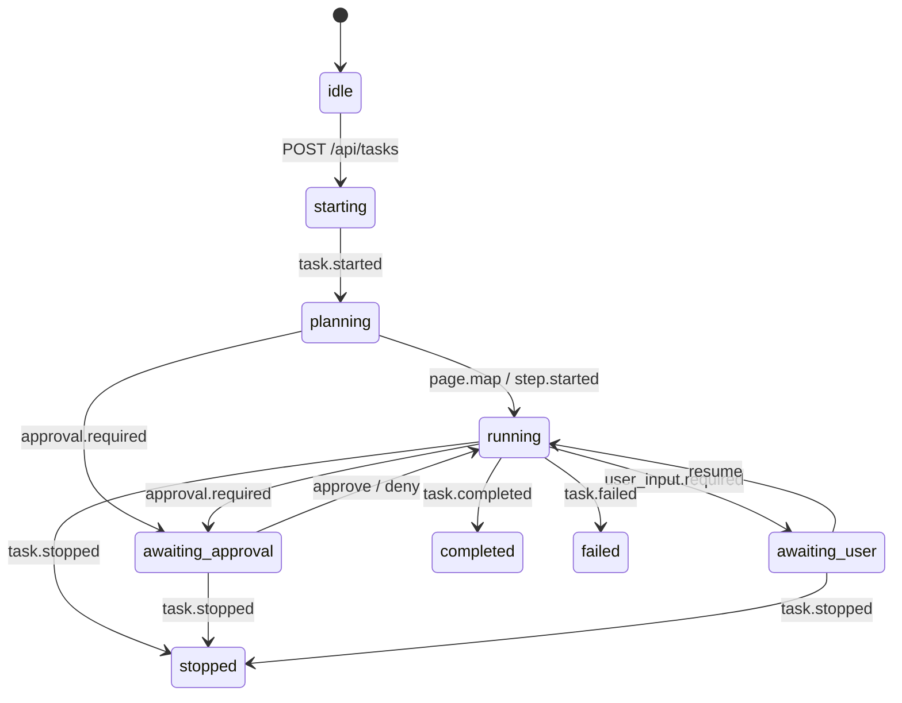

# AccessPilot frontend ↔ backend contract

This is the agreement between the Next.js UI and the backend API routes and orchestrator.
The code in [`lib/contracts/`](../lib/contracts/) is the source of truth: TypeScript types plus
zod schemas. Import them in route handlers so both sides validate the same way:

```ts
import { startTaskRequestSchema, taskEventSchema, apiPaths, type TaskEvent } from "@/lib/contracts";
```

If anything here disagrees with `lib/contracts/`, the code wins. Please report the mismatch.

## Contents

- [HTTP endpoints](#http-endpoints)
- [Error responses](#error-responses)
- [Event stream (SSE)](#event-stream-sse)
- [Event reference](#event-reference)
- [Rules the frontend applies to incoming events](#rules-the-frontend-applies-to-incoming-events)
- [Task lifecycle](#task-lifecycle)
- [Safety rules the backend must uphold](#safety-rules-the-backend-must-uphold)
- [Changelog](#changelog)

## HTTP endpoints

All bodies are JSON (`Content-Type: application/json`). Task ids in paths are URL-encoded; use
`apiPaths` to build them.

| Method & path                 | Request body (schema)                                                     | Success                                                  |
| ----------------------------- | ------------------------------------------------------------------------- | -------------------------------------------------------- |
| `POST /api/tasks`             | `{ url, goal, details? }` (`startTaskRequestSchema`)                      | `201` or `200`, `{ taskId }` (`startTaskResponseSchema`) |
| `GET /api/tasks/:id/events`   | none                                                                      | `200`, `text/event-stream` of `TaskEvent`                |
| `POST /api/tasks/:id/approve` | `{ approvalId }` (`approveRequestSchema`)                                 | `204`                                                    |
| `POST /api/tasks/:id/deny`    | `{ approvalId, reason? }` (`denyRequestSchema`)                           | `204`                                                    |
| `POST /api/tasks/:id/resume`  | `{}` (`emptyRequestSchema`), sent after the user finishes a hand-off step | `204`                                                    |
| `POST /api/tasks/:id/stop`    | `{}` (`emptyRequestSchema`)                                               | `204`                                                    |

### Request field rules

- `url`: trimmed. Must be `https://…`, or `http://` on `localhost`, `127.0.0.1` or `[::1]` (for
  the demo site). URLs with embedded credentials (`https://user:pass@…`) are rejected. Shared
  helper: `isAllowedTaskUrl(url)`.
- `goal`: trimmed, 1 to 1000 characters (`GOAL_MAX_LENGTH`).
- `details` (optional, `profileDetailsSchema`): what the user saved under Settings, "Your details":
  `name` (up to 200), `email` (up to 200), `phone` (up to 50) and free-text `notes` (up to 1000), all
  optional and trimmed. The backend uses them instead of its demo profile, after removing any line that
  looks like a password, code or card number. Never send secrets here.
- `approvalId`: must be the id from the most recent `approval.required` event for that task.
- `reason` (deny): optional, at most 500 characters. Free text from the user; treat it as untrusted.

### Idempotency expectations

- `stop` on a task that already ended should return `204`, not an error. The user may press Stop
  at the same moment the task finishes.
- `approve` or `deny` with a stale or unknown `approvalId` returns `409 invalid_state` or
  `404 approval_not_found`. It must never act on a different pending approval.

### How the frontend reacts to failed actions

The status code decides what the user sees, so please use these consistently:

| Response to `approve` / `deny` / `resume` | Frontend behavior                                                                                                           |
| ----------------------------------------- | --------------------------------------------------------------------------------------------------------------------------- |
| `409`                                     | The question is closed on the server. The dialog or hand-off is **not** shown again; the UI waits for your next event.      |
| `404`                                     | The task is gone. The task ends in the UI as failed, so the user is never stuck answering a question nobody is waiting for. |
| Network error or `5xx`                    | Temporary. The dialog or hand-off comes back so the user can answer again.                                                  |

| Response to `stop` | Frontend behavior                                                                                                                                                                    |
| ------------------ | ------------------------------------------------------------------------------------------------------------------------------------------------------------------------------------ |
| `204`              | Stopped.                                                                                                                                                                             |
| Anything else      | The UI still shows the task as stopped (the user asked to stop and must not be trapped) and warns that the server may not have stopped. Please make `/stop` as reliable as possible. |

A `404`, `405`, or `502`–`504` on `POST /api/tasks` is shown as "AccessPilot's server isn't
available right now", not as a missing task.

## Error responses

> **Added by the frontend; see the changelog.**

Every non-2xx response has this body (`apiErrorResponseSchema`):

```json
{ "error": { "code": "invalid_state", "message": "This task is no longer waiting for approval." } }
```

- `message` is shown to the user as-is, so write it in plain language and say what to do next.
  Never include stack traces, keys or internal ids.
- Suggested `code` values (`API_ERROR_CODES`): `invalid_request` (400), `task_not_found` (404),
  `approval_not_found` (404), `invalid_state` (409), `internal_error` (500). Other codes are
  allowed. The frontend falls back to a generic message for anything it doesn't recognize.
- If the body is missing or malformed, the frontend still handles the error, using only the
  HTTP status.

## Event stream (SSE)

> **Framing added by the frontend; see the changelog.**

`GET /api/tasks/:id/events` returns `Content-Type: text/event-stream` and
`Cache-Control: no-cache`. The frontend reads it with the browser's `EventSource`.

Each `TaskEvent` is one SSE message:

```
id: 7
data: {"type":"narration","taskId":"task_1","seq":7,"at":"2026-10-25T14:00:03.120Z","text":"Opening the program dropdown.","priority":"polite"}

```

- Put the whole event in a single `data:` line as compact JSON.
- Set `id:` to the event's `seq`. On reconnect the client sends the last `seq` it received as a
  `?lastEventId=<seq>` query parameter. A new `EventSource` can't set the `Last-Event-ID` header,
  so please accept both. The server should replay every event with `seq` greater than that value,
  or replay everything; the client drops duplicates either way.
- Don't set an `event:` field. The client listens to the default `message` event only.
- Comment lines (`: keep-alive`) are fine for heartbeats and are ignored. Send one at least
  every 15 seconds so proxies don't close an idle stream.
- After a terminal event (`task.completed`, `task.failed`, `task.stopped`), close the stream.
  The client also closes it as soon as it sees a terminal event.
- Subscribing to a task that has already ended should replay its events, including the terminal
  one, and then close.

Reconnects: if the connection drops before a terminal event, the client closes it and opens a
new one after 0.5 s, 1 s, 2 s, 4 s and then 8 s. It gives up after 5 failed attempts in a row
and tells the user. Receiving any valid event resets the count.

Events can arrive before the matching HTTP response. For example, `task.stopped` may arrive
before `POST /stop` returns `204`, and the next `step.started` may arrive before `POST /approve`
does. The client handles either order.

## Event reference

Every event has this envelope:

| Field    | Type    | Notes                                                                         |
| -------- | ------- | ----------------------------------------------------------------------------- |
| `type`   | string  | Discriminator, one of the types below.                                        |
| `taskId` | string  | Non-empty.                                                                    |
| `seq`    | integer | ≥ 0, strictly increasing per task. Each event gets a new `seq`, never reused. |
| `at`     | string  | ISO 8601 datetime, `Z` or numeric offset (`2026-10-25T10:00:00-04:00`).       |

"Text" in the tables below means a string that is non-empty after trimming.

| `type`                | Payload fields                                                                                                                                 | Purpose                                                                                                              |
| --------------------- | ---------------------------------------------------------------------------------------------------------------------------------------------- | -------------------------------------------------------------------------------------------------------------------- |
| `task.started`        | `url`: text, `goal`: text                                                                                                                      | Echo of the accepted request. Always the first event.                                                                |
| `page.map`            | `title`: text, `summary`: text, `regions`: `{ name: text, description: string }[]`                                                             | Announced on arrival: "This page has a login, a 6-field form, and a Submit button." May be re-sent after navigation. |
| `step.started`        | `step`: int ≥ 1, `description`: text, `totalSteps?`: int ≥ 1                                                                                   | "Step 3 of about 6: Choosing a program". `totalSteps` is an estimate and may change.                                 |
| `step.completed`      | `step`: int ≥ 1, `description`: text, `action`: `{ type: "click" \| "double_click" \| "type" \| "key" \| "scroll" \| "wait", label?: string }` | Marks the step done. `label` is what was acted on ("Computer Science").                                              |
| `narration`           | `text`: text, `priority`: `"polite" \| "assertive"`                                                                                            | Spoken and shown in the log. Use `assertive` only for things that need attention right now.                          |
| `screenshot`          | `step`: int ≥ 0, `imageDataUrl`: see below, `alt`: text                                                                                        | Preview of the controlled browser. `step` 0 means "before the first step".                                           |
| `approval.required`   | `approvalId`: text, `action`: text, `summary`: text, `fields`: `{ label: text, value: string }[]`                                              | Opens the approval dialog. The agent must wait for `approve` or `deny`.                                              |
| `user_input.required` | `reason`: `"sensitive_value" \| "captcha" \| "login" \| "other"`, `instructions`: text                                                         | Hands control to the user. The agent waits for `resume`.                                                             |
| `task.completed`      | `summary`: text                                                                                                                                | Terminal. "Submitted. Confirmation number 4821." Also used after a denied approval ("Not submitted…").               |
| `task.failed`         | `code`: text, `message`: text, `recoverable`: boolean                                                                                          | Terminal. `message` is user-facing. `recoverable: true` shows a "Try again" option.                                  |
| `task.stopped`        | `by`: `"user" \| "system"`                                                                                                                     | Terminal. Sent after `/stop` (`user`) or when the backend aborts on its own (`system`).                              |

### Field notes

- **`imageDataUrl`** must match `^data:image/(png|jpeg|webp);base64,[A-Za-z0-9+/]+={0,2}$`
  (`IMAGE_DATA_URL_PATTERN`). Remote URLs, SVG and anything with extra characters are rejected,
  and the whole event is dropped. Keep each screenshot under about 500 KB (downscale or use
  JPEG/WebP), since it travels inside the SSE stream.
- **`alt`** is the only way screen reader users get the screenshot, so describe what matters for
  the task ("Program dropdown open, Computer Science highlighted"), not the pixels.
- **`approval.required.fields`** are read aloud and shown as a definition list. Include every
  value the action will commit (name, amount, recipient…). Mask secrets (`•••• 4242`). `value` may
  be empty.
- **`user_input.required.instructions`** should say exactly what to do in the browser window and
  end with the next step: "Please type your password in the browser window, then press Continue."
- All strings are rendered as plain text, never HTML. Markup in them shows up literally.

### Example sequence (approved submit)

```jsonc
{ "type": "task.started", "seq": 1, "url": "http://localhost:4000/scholarship", "goal": "Complete this scholarship application" }
{ "type": "page.map", "seq": 2, "title": "Scholarship application", "summary": "This page has a 6-field form and a Submit button.", "regions": [{ "name": "Application form", "description": "Name, email, program, start date, essay" }] }
{ "type": "step.started", "seq": 3, "step": 1, "description": "Filling in your name", "totalSteps": 6 }
{ "type": "narration", "seq": 4, "text": "Typing your name.", "priority": "polite" }
{ "type": "step.completed", "seq": 5, "step": 1, "description": "Filled in your name", "action": { "type": "type", "label": "Full name" } }
{ "type": "screenshot", "seq": 6, "step": 1, "imageDataUrl": "data:image/png;base64,…", "alt": "Name field filled with Ada Lovelace" }
// … steps 2 to 5 …
{ "type": "approval.required", "seq": 30, "approvalId": "appr_1", "action": "Submit application", "summary": "Submit the scholarship application?", "fields": [{ "label": "Name", "value": "Ada Lovelace" }] }
// client: POST /api/tasks/task_1/approve { "approvalId": "appr_1" } → 204
{ "type": "step.started", "seq": 31, "step": 6, "description": "Submitting the application", "totalSteps": 6 }
{ "type": "task.completed", "seq": 34, "summary": "Submitted. Confirmation number 4821." }
```

(`taskId` and `at` are omitted above for brevity. Every real event includes them.)

## Rules the frontend applies to incoming events

The backend can rely on this behavior:

1. **Validation.** Every message is validated with `parseTaskEventData`, which returns one of:
   - `event`: valid, applied to the UI.
   - `unknown`: a `type` this frontend doesn't know. Ignored, and logged in development only.
     New event types are therefore safe to add before the UI supports them.
   - `invalid`: not JSON, or a known type with a bad payload. Dropped, and the user sees a
     non-fatal warning. The task keeps running.
2. **Additive fields are safe.** Unknown fields on known events are stripped, not rejected.
3. **Deduplication.** Events whose `seq` is ≤ the highest `seq` already applied for that task are
   ignored. This is what makes reconnect replay safe.
4. **Untrusted text.** All event text is treated as untrusted data and rendered as text.
5. **State gating.** Events that don't fit the current task state (for example `step.started`
   after `task.completed`) are ignored and logged in development.

## Task lifecycle



`task.failed` and `task.stopped` may arrive in any non-terminal state. The full transition table
lives in `lib/client/taskState.ts`.

## Safety rules the backend must uphold

The UI enforces its side, but these are backend guarantees:

- **No consequential action without approval.** Any action Twinly flags `commits: true`
  (submit, pay, send, delete) must emit `approval.required` and block until `approve` with that
  exact `approvalId`. `deny` must not perform the action. Continue with narration, then finish
  with `task.completed` whose summary says it was not done ("Not done: Submit application. I
  stopped there, so nothing was submitted or changed.").
- **No auto-approval and no timeout that approves.** If you add a timeout, it must end in
  `deny` behavior or `task.stopped` (`by: "system"`).
- **Hand off what the agent must not do.** Password fields, card numbers and CAPTCHAs produce
  `user_input.required` and wait for `resume`. Never type those values and never put them in events.
- **Stop is immediate.** After `/stop`, perform no further browser actions. Emit `task.stopped`
  (`by: "user"`) and close the stream.
- **Keys stay server-side.** The browser never talks to Twinly or Gemini directly.

## Changelog

Changes the frontend made to the original spec, with reasons:

| Date       | Change                                                                                                                                                              | Rationale                                                                                                                                                                   |
| ---------- | ------------------------------------------------------------------------------------------------------------------------------------------------------------------- | --------------------------------------------------------------------------------------------------------------------------------------------------------------------------- |
| 2026-10-24 | Added optional `totalSteps` to `step.started`.                                                                                                                      | The progress UI needs "Step 3 of about 6" and a `<progress>` bar. Optional, so the backend can omit it when it doesn't know.                                                |
| 2026-10-24 | Defined the error body `{ error: { code, message } }` for non-2xx responses.                                                                                        | Lets the client raise typed errors and show a helpful message instead of a bare status code.                                                                                |
| 2026-10-24 | Defined SSE framing: one JSON `data:` line, `id:` = `seq`, no `event:` name, close after a terminal event.                                                          | Makes `Last-Event-ID` reconnect work and keeps server and client parsing identical.                                                                                         |
| 2026-10-24 | `url` must be `https:`, or `http:` on localhost / 127.0.0.1 / [::1], with no embedded credentials.                                                                  | Same rule in the form and the API (`taskUrlSchema`), so the user gets the error before a round trip. Loopback IPs added for the demo site.                                  |
| 2026-10-24 | `goal` limited to 1000 characters. `deny.reason` limited to 500.                                                                                                    | Bounds what reaches the model prompt.                                                                                                                                       |
| 2026-10-24 | Text fields must be non-empty after trimming. `screenshot.step` may be 0. `imageDataUrl` must have a base64 body.                                                   | Empty narration or alt text is useless to a screen reader user. Step 0 covers the initial page screenshot.                                                                  |
| 2026-10-24 | Unknown fields are stripped, not rejected.                                                                                                                          | Lets the backend add fields without coordinating a frontend release.                                                                                                        |
| 2026-10-24 | Reconnects send `?lastEventId=<seq>` on the events URL.                                                                                                             | The client controls its own backoff, so it opens a new `EventSource`, and a new one can't send the `Last-Event-ID` header.                                                  |
| 2026-10-24 | `approval.required` is accepted before any `page.map` or `step.started`.                                                                                            | A safety-critical question must never be dropped silently because it arrived early.                                                                                         |
| 2026-10-24 | `url` rejects whitespace, zero-width and other invisible characters, `%` in the host, and hosts without a dot (except localhost). `goal` must contain visible text. | User testing found addresses that browsers silently rewrote (`https://exa<U+200B>mple.com` became `example.com`), so the opened address differed from the one the user saw. |
| 2026-10-24 | Defined how failed `approve`/`deny`/`resume`/`stop` and a failed start are handled (see "How the frontend reacts to failed actions").                               | User testing with a backend returning 404s left users trapped in the approval dialog.                                                                                       |
| 2026-10-25 | Added optional `details` to `POST /api/tasks`.                                                                                                                      | Lets users fill forms with their own details (Settings, "Your details") instead of the built-in demo profile. Optional, so older clients are unaffected.                    |
